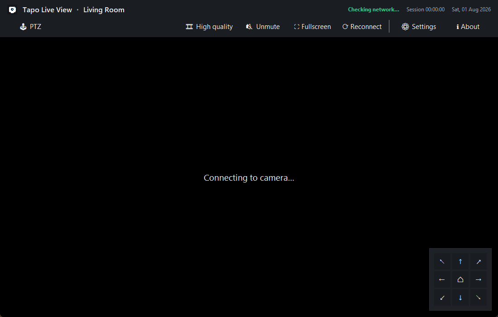
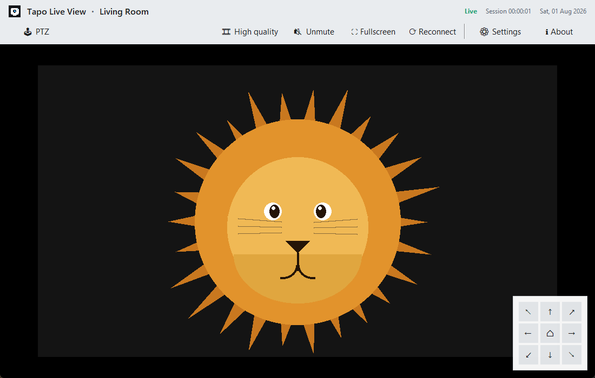
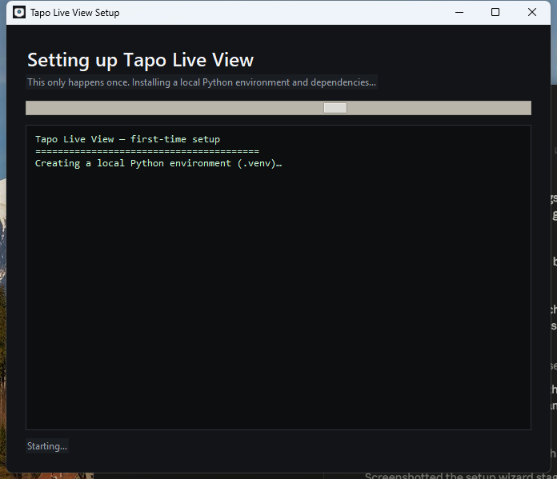
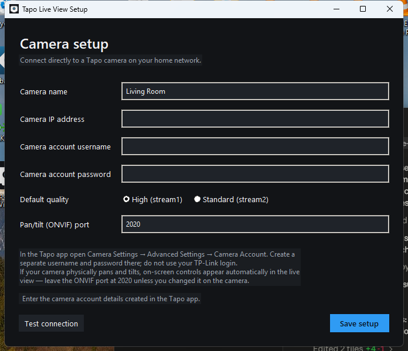
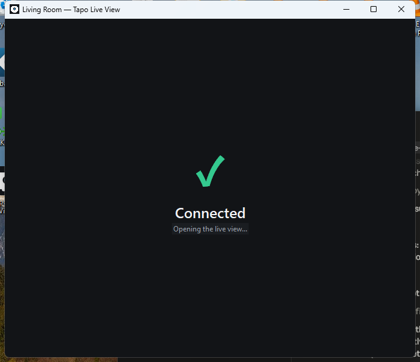
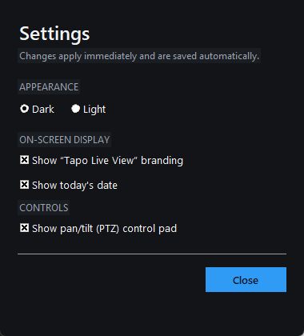

# Tapo Live View

A modern Windows desktop app that opens your TP-Link Tapo cameras' local RTSP live feeds in its own window — direct to the camera over your home network, no browser and no Tapo cloud login involved.

> The screenshots below use a placeholder lion illustration instead of a real camera feed.

| Live view (dark) | Live view (light) |
|---|---|
|  |  |

## Features

- One-click live view from a Windows desktop shortcut — no terminal window, ever
- The window opens instantly with a loading screen, then a camera list showing which cameras are online
- Multiple cameras: pick one to watch, switch from the toolbar, or toggle **Multi view** to watch them all in a grid
- Direct local-network RTSP connection, decoded locally with FFmpeg/ffplay
- High-quality (`stream1`) and standard-quality (`stream2`) switching (🎞 HD / SD)
- Reconnect, mute/unmute and fullscreen controls
- On-screen pan/tilt controls over ONVIF for cameras that physically move, rendered as an always-on-top overlay so they never get hidden behind the video
- Light and dark themes
- A live session timer and today's date in the toolbar
- A **Settings** panel (opens inside the app window) with a theme switch and toggles for the branding, the date and the PTZ pad
- An **About** panel with a link back to this repository
- Camera password stored in Windows Credential Manager, not `config.json`
- A guided setup wizard: install → camera setup → live view, all in one window, with a green checkmark once the connection test passes

## Requirements

- Windows 10 or Windows 11
- Python 3.9 or newer (the setup wizard installs everything else for you)
- FFmpeg, including `ffplay.exe` (the wizard can install this via `winget`)
- A wired Tapo camera that supports RTSP, such as many C100/C110/C200/C210 models
- PC and camera connected to the same local network

## Camera preparation

1. Add the camera normally in the Tapo mobile app.
2. Give the camera a stable IP address using your router's DHCP reservation feature.
3. In the Tapo app, open **Camera Settings → Advanced Settings → Camera Account**.
4. Create a camera username and password. This is separate from your TP-Link account.

## Install

1. Extract this folder somewhere permanent, for example `C:\Tools\tapo-live-view`.
2. Double-click `Setup.bat`. A window opens showing install progress (no console, ever) —

   

3. It moves straight into camera setup in the same window:

   

4. Enter the camera name, IP address and Camera Account credentials, then **Test connection** and **Save setup**. A green checkmark confirms the connection before the live view opens automatically:

   

5. Run `Create Desktop Shortcut.bat` so **Tapo Live View** opens straight from the desktop next time — with no console flash at all. The shortcut launches the app's windowless Python directly; if you made a shortcut with an older version (one pointing at `Run.bat`), run this again to replace it.

Day to day, use the desktop shortcut (`Run.bat` also works, but as a `.bat` file Windows briefly shows a console window first). The window appears straight away with a loading screen, then shows your camera list.

## Cameras and multi view

- **Camera list** — after loading, every camera gets a card showing whether it's online (checked in the background). Click a card to watch it.
- **Add camera** — the ＋ card or button opens the same setup form; each camera's password is stored separately in Windows Credential Manager. The ✕ on a card removes that camera.
- **Switch camera** — in the live view, the 📷 dropdown switches to another camera without going back; **◀ Cameras** returns to the list.
- **Multi view** — the **▦ Multi view** button (in the list or the toolbar) shows all cameras in a grid and toggles back to a single camera. Click a tile's title bar to select it (PTZ and audio follow the selected tile); double-click it to open that camera on its own. Multi view uses the lighter `stream2` by default — **🎞 HD/SD** switches it.
- Existing single-camera `config.json` files are converted to the new `cameras` list automatically.

## Settings

Open **⚙ Settings** from the toolbar (or the camera list). It opens as a panel inside the app window, and every change applies and saves immediately:

- **Appearance** — light or dark theme, applied instantly
- **On-screen display** — show/hide the "Tapo Live View" branding and today's date
- **Controls** — show/hide the pan/tilt (PTZ) pad

There's also a one-click **🕹 PTZ** toolbar button for quickly hiding/showing the pad without opening Settings.



## Pan/tilt controls

If your camera model physically pans and tilts (for example Tapo C200/C210/C225), a directional pad appears automatically over the bottom-right corner of the live view. It uses the camera's ONVIF service (by default port `2020`) with the same Camera Account credentials as RTSP — no extra setup beyond what the wizard already asks for.

- The pad only appears after the app confirms the camera supports PTZ; fixed-position cameras never show it.
- It renders in its own always-on-top overlay window, so it stays visible on top of the video instead of being hidden behind it.
- Press and hold a direction to move, release to stop; the center button returns to the camera's home position (if it has one).
- If your camera uses a non-default ONVIF port, set it during setup or edit `onvif_port` in `config.json`.
- `ptz_speed` in `config.json` (0.0–1.0, default `0.5`) controls how fast the camera moves.
- Hide it any time from **⚙ Settings** or the toolbar's **🕹 PTZ** button.

## About

Click **ℹ About** in the toolbar for a short description of the app and a link back to this repository: https://github.com/andreiele/tapo-live-view

## Files

| File | Purpose |
|---|---|
| `Setup.bat` / `Run.bat` | Launchers that hand off to `run_hidden.vbs` (prefer the desktop shortcut day to day) |
| `run_hidden.vbs` | Launches the wizard with `pythonw`/`py -3w`, invisibly |
| `wizard.py` | The app's single window: install → setup → loading → camera list → live |
| `Create Desktop Shortcut.bat` | Creates a desktop shortcut that runs `.venv\Scripts\pythonw.exe wizard.py` directly — no console |
| `first_run.py` | Camera setup form, used standalone or embedded in the wizard |
| `selector.py` | Loading screen and camera list (online status, add/remove, multi view) |
| `live.py` | The live view: one camera or a multi-view grid of embedded ffplay players, PTZ overlay, timer |
| `theme.py` | Light/dark palettes, ttk styling, window icon helper |
| `modal.py` | In-window panel base (dimmed backdrop + card), toggle switch and segmented control |
| `settings_window.py` | Settings panel (theme, branding, date, PTZ toggles) |
| `about_window.py` | About panel |
| `app_common.py` | Configuration, RTSP URL, credential and network helpers |
| `ptz.py` | ONVIF pan/tilt controller used by the live view |
| `demo_player.py` / `assets/lion.png` | Stand-in video source used only by `TAPO_DEMO=1` (screenshots/QA) |
| `config.example.json` | Example configuration without credentials |

## Troubleshooting

### Camera port is unreachable

Confirm the PC and camera are on the same Wi-Fi/LAN and are not separated by guest-network or AP-isolation settings. Verify the IP in the Tapo app or router.

### Authentication or stream error

Recreate the **Camera Account** in the Tapo app. This app does not use the email/password for your TP-Link account.

### High quality does not connect

Try **Standard quality**. Other Tapo app, NVR, RTSP or Tapo Care sessions may already be using the available camera streams.

### No pan/tilt controls appear

Your camera model is likely fixed-position (many Tapo cameras, including most `C1xx` models, do not physically move). If the camera does support PTZ, confirm ONVIF is reachable at `<camera IP>:2020` and that the Camera Account credentials are correct; check `tapo-live.log` for the specific ONVIF error. You can also confirm it isn't just hidden — check **⚙ Settings → Show pan/tilt (PTZ) control pad**.

### ffplay is missing

Open Command Prompt and run:

```bat
winget install --id Gyan.FFmpeg -e
```

Then reopen the terminal or sign out and back in so the updated PATH is available.

### Logs

See `tapo-live.log` in the project folder. Passwords and full RTSP URLs are not written to the log.

## Security

- Keep this app local to your home network.
- Do not expose RTSP port 554 or the ONVIF port (2020 by default) through your router.
- `config.json` contains the camera IP and username, but not the password.
- The password is stored using Python Keyring in Windows Credential Manager.

## Known limitations

- This build targets Windows because it embeds `ffplay` with the Win32 API.
- Pan/tilt only appears for camera models that physically support it; zoom is not implemented.
- Battery-powered Tapo cameras commonly do not support continuous RTSP.
